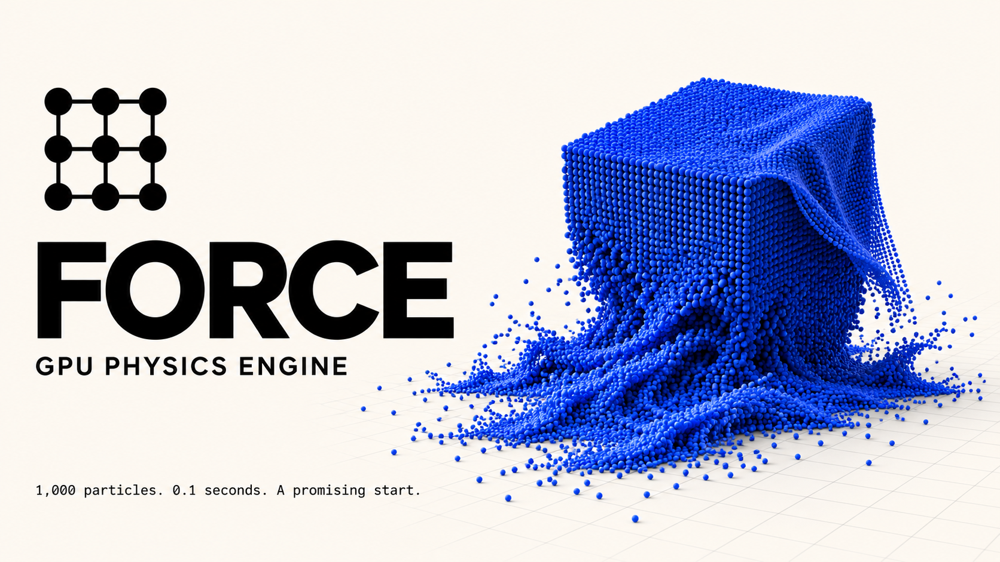

# FORCE

A GPU-first physics engine for the web, built on [WebGPU](https://www.w3.org/TR/webgpu/).

> **Status: early development.** FORCE is being built in the open, one step at a time, and
> studying how physics engines work is part of the job. The package is not published on npm, and
> the API will change without notice.

## Where we are

*Updated November 14, 2026*

**Latest step:** [the living map](./docs/logbook/011-the-living-map.md). The map of everything we
have met while studying is now a graph in 3D: one point per topic, filled according to how far we
went with it. You can click a topic to read its page, and replay day by day how the map grew. It
runs with `npm run dev`, under `topic-map`. Before it, a first series of
[WebGPU mini guides](./docs/guides/README.md): buffers, compute shaders and pipelines.

**Next:** back to the guides, with bind groups: how a shader finds its data.

Every step, with what we learned and what went wrong, is in the [logbook](./docs/README.md).

## Goals

- Run the simulation on the GPU with WebGPU compute shaders.
- Stay independent of any rendering library.
- Add a WebGL fallback later on.

## Requirements

A [browser with WebGPU support](https://github.com/gpuweb/gpuweb/wiki/Implementation-Status),
on a page served from HTTPS or localhost.

The WebGPU types are built into TypeScript 6 and later. On TypeScript 5, also install
[`@webgpu/types`](https://www.npmjs.com/package/@webgpu/types).

## Usage

```js
import { World } from 'force-gpu'

// x, y, z for each particle, in meters
const positions = new Float32Array([0, 10, 0, 1, 12, 0])
const world = await World.create({ device, positions })

function frame(frameTime) {
  // seconds since the last frame: the engine runs as many fixed steps as they hold
  world.update(frameTime)
}
```

**Give FORCE your renderer's GPU device.** A buffer created on one device cannot be used on
another, so if FORCE and your renderer each had their own, every position would have to travel
through the CPU between them. When no `device` is given, FORCE requests one of its own: fine for a
page that only simulates. Examples with three.js and other libraries will follow.

## Documentation

The development logbook and study notes are in [docs/](./docs/README.md).

## Development

```sh
npm install
npm run dev        # serve the examples
npm test           # run the unit tests
npm run typecheck  # check types
npm run lint       # check lint and formatting
npm run build      # build the package into dist/
```

| Path        | Contents                                   |
| ----------- | ------------------------------------------ |
| `src/`      | The library                                |
| `test/`     | Unit tests                                 |
| `examples/` | Runnable demos, importing from `force-gpu` |

## Contributing

FORCE is studied in the open. If you know a paper, a talk or an engine worth studying, or you spot a
mistake in the docs, see [CONTRIBUTING.md](./CONTRIBUTING.md).

## License

[MIT](./LICENSE)
