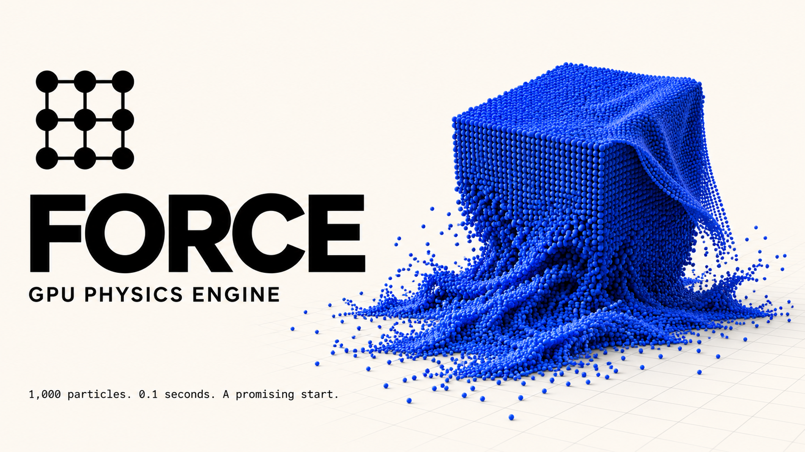

# FORCE

A GPU-first physics engine for the web, built on [WebGPU](https://www.w3.org/TR/webgpu/).

**[Documentation →](https://rock-biter.github.io/force/)** The website of the project. For now it
has the examples running in the browser, the logbook and the topic map in 3D. The full
documentation of the library will live there too.

> **Status: early development.** FORCE is being built in the open, one step at a time, and
> studying how physics engines work is part of the job. The package is not published on npm, and
> the API will change without notice.

## Where we are

*Updated November 25, 2026*

**Latest steps:** chapters [038](./docs/logbook/038-one-hundred-twenty-five-cells.md),
[039](./docs/logbook/039-far-apart-in-memory.md) and [040](./docs/logbook/040-the-table.md). To find
which particles touch, each one looks into the small cells of space around it
([try it](https://rock-biter.github.io/force/tilted-box/)). We timed every part of a step and found
that this search took most of it: each particle read 125 cells where we believed 27, and the way of
storing the cells we liked best scattered them in memory. With both fixed, a pile of 50 000 particles
in a corner takes 8 ms a step instead of 13, loses no particle, and the cells cost 1 MB whatever the
size of the world.

Then we moved the particles themselves into the order of their cells
([chapter 041](./docs/logbook/041-next-to-each-other.md)): faster again, and much more so with one
way of storing the cells than with the one we had just chosen.

Last, a study with [charts](https://rock-biter.github.io/force/cells-study/) of what makes one way
better than another: the size of the world, above all
([chapter 042](./docs/logbook/042-no-best-way.md)).

**You can help:** [run the benchmark](https://rock-biter.github.io/force/bench/) on your own device,
a computer or a phone, and send us the numbers ([chapter 043](./docs/logbook/043-other-peoples-devices.md)).

The first devices are in, with thanks to those who sent them
([chapter 044](./docs/logbook/044-the-first-devices.md)).

The live page now holds up to a million particles, and a step got cheaper: friction read every
particle's neighbours twice, and now reads them once
([chapter 045](./docs/logbook/045-a-million-and-one-pass.md)).

Before going on with the engine, we gave the particles of our viewer soft shadows
([try it](https://rock-biter.github.io/force/debug-viewer/)). The trick that would make them cheap is
not in the browsers yet ([chapter 046](./docs/logbook/046-a-promise-not-yet-kept.md)), so every
sphere first writes only what it shows, and the light is worked out once for each pixel of the
screen. We timed it against the usual way, up to a million particles: with shadows it always wins
([chapter 047](./docs/logbook/047-once-per-pixel.md)).

Back to the engine, with a question: can particles have different sizes? A test says yes, up to a
large one twice as wide as a small one ([chapter 048](./docs/logbook/048-big-and-small.md)), and
there is a page to try it, with grains of one material or of several
([try it](https://rock-biter.github.io/force/mixed-sizes/),
[chapter 049](./docs/logbook/049-a-radius-each.md)). 31 runs of the benchmark are in.

Each particle kept a list of its neighbours, which cost memory. We timed a step without the lists:
much slower, unless the particles are kept in the order of the cells they are in, and then about the
same. So the particles are now always in order, and the lists are gone
([chapters 050](./docs/logbook/050-the-price-of-remembering.md) to
[054](./docs/logbook/054-without-the-lists.md)).

With the lists gone, sizes can be further apart, up to 4 to 1. It works well when the sizes are
spread, and badly with only very large and very small ones together
([chapter 055](./docs/logbook/055-further-apart.md)).

Next come particles joined by springs, and we started from the physics: what a spring is, in four
ideas ([chapter 056](./docs/logbook/056-what-a-spring-is.md), and the page
[Springs](./docs/topics/spring.md)).

Then why a stiff spring blows up in a simulation, and the three ways around it
([chapter 057](./docs/logbook/057-three-ways-around.md)).

And how six engines set theirs ([chapter 058](./docs/logbook/058-how-engines-set-a-spring.md)).

Now the design: since particles are moved in memory at every substep, how does a spring find its
two ends? Two ways, timed ([chapter 059](./docs/logbook/059-a-name-or-a-corrected-list.md)).

We chose names: a spring says who its two particles are, and a register says where they are now.

Then how several springs on one particle combine: the rule we use for contacts blows up on a
cloth ([chapter 060](./docs/logbook/060-one-by-one-or-all-at-once.md)).

Solving them one after the other, in groups that share no particle, is as cheap on the GPU and
ten times tighter ([chapter 061](./docs/logbook/061-a-dispatch-per-group.md)).

And the first springs run on a live page: ropes that hang and swing
([try it](https://rock-biter.github.io/force/ropes/),
[chapter 062](./docs/logbook/062-the-first-ropes.md)).

Then a cloth, the same springs joined into a net
([try it](https://rock-biter.github.io/force/cloth/),
[chapter 063](./docs/logbook/063-a-cloth.md)).

A spring is now as soft as asked, whatever the passes over it
([chapter 064](./docs/logbook/064-as-soft-as-asked.md)).

And it has two brakes: one for its own bounce, one, like air, for whatever it is tied to
([chapter 065](./docs/logbook/065-two-kinds-of-brake.md)).

The cloth also resists folding now, with springs that skip a particle
([chapter 066](./docs/logbook/066-against-the-fold.md)).

**Next:** springs for any net, and lighter particles. Then our rules read again against the
devices.

Every step, with what we learned and what went wrong, is in the [logbook](./docs/README.md).

## Goals

- Run the simulation on the GPU with WebGPU compute shaders.
- Stay independent of any rendering library.
- Add a WebGL fallback later on.

## Requirements

A [browser with WebGPU support](https://github.com/gpuweb/gpuweb/wiki/Implementation-Status),
on a page served from HTTPS or localhost.

The WebGPU types are built into TypeScript 6 and later. On TypeScript 5, also install
[`@webgpu/types`](https://www.npmjs.com/package/@webgpu/types).

## Usage

```js
import { World } from 'force-gpu'

// x, y, z for each particle, in meters
const positions = new Float32Array([0, 10, 0, 1, 12, 0])
const world = await World.create({ device, positions })

function frame(frameTime) {
  // seconds since the last frame: the engine runs as many fixed steps as they hold
  world.update(frameTime)
}
```

**Give FORCE your renderer's GPU device.** A buffer created on one device cannot be used on
another, so if FORCE and your renderer each had their own, every position would have to travel
through the CPU between them. When no `device` is given, FORCE requests one of its own: fine for a
page that only simulates. Examples with three.js and other libraries will follow.

## Documentation

The development logbook and study notes are in [docs/](./docs/README.md).

## Development

```sh
npm install
npm run dev        # serve the examples
npm test           # run the unit tests
npm run typecheck  # check types
npm run lint       # check lint and formatting
npm run build      # build the package into dist/
npm run build:site # build the website into _site/
```

| Path        | Contents                                   |
| ----------- | ------------------------------------------ |
| `src/`      | The library                                |
| `test/`     | Unit tests                                 |
| `examples/` | The website: home page, demos and the lab  |

## Contributing

FORCE is studied in the open. If you know a paper, a talk or an engine worth studying, or you spot a
mistake in the docs, see [CONTRIBUTING.md](./CONTRIBUTING.md).

## License

[MIT](./LICENSE)
